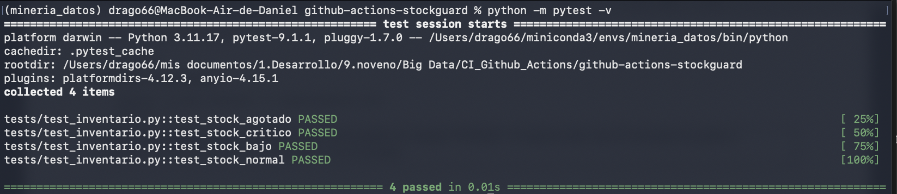
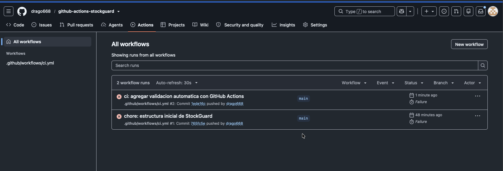
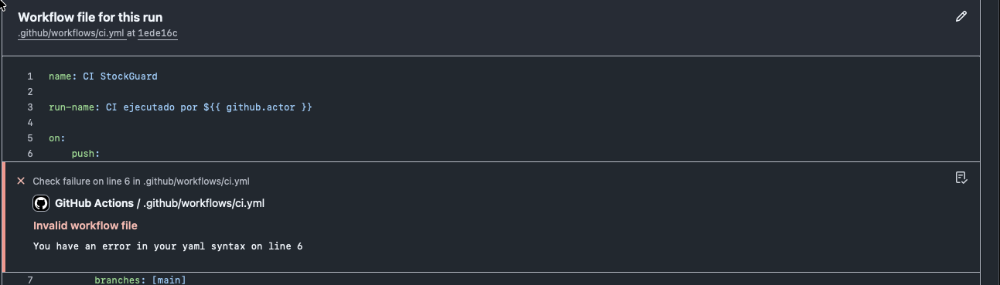
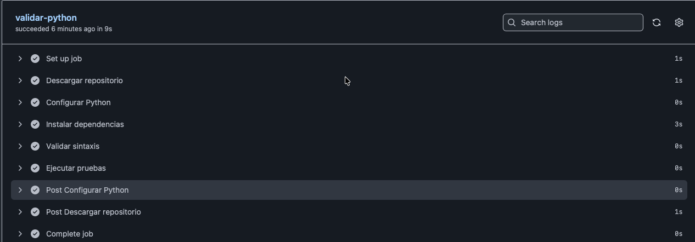
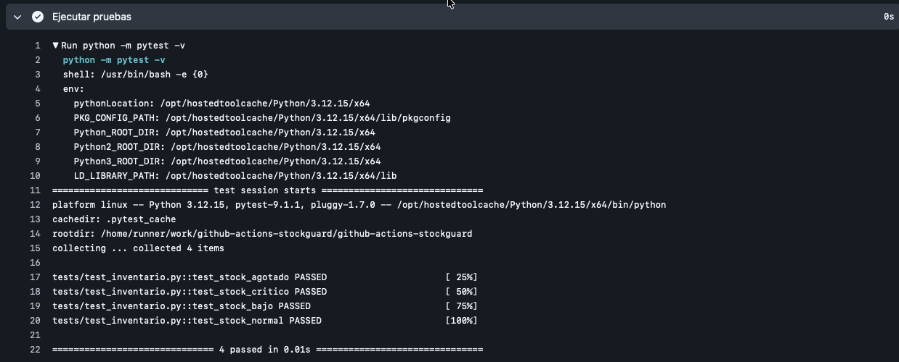
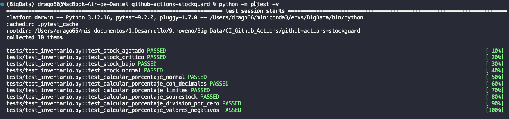
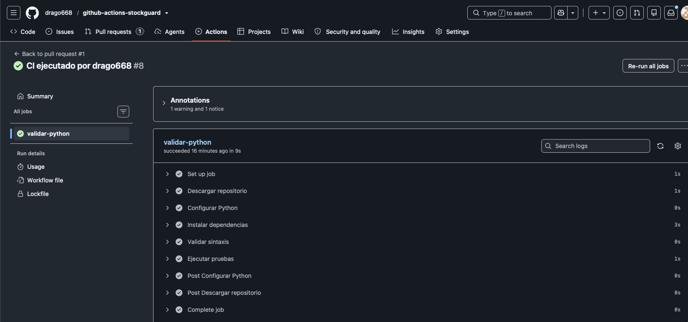
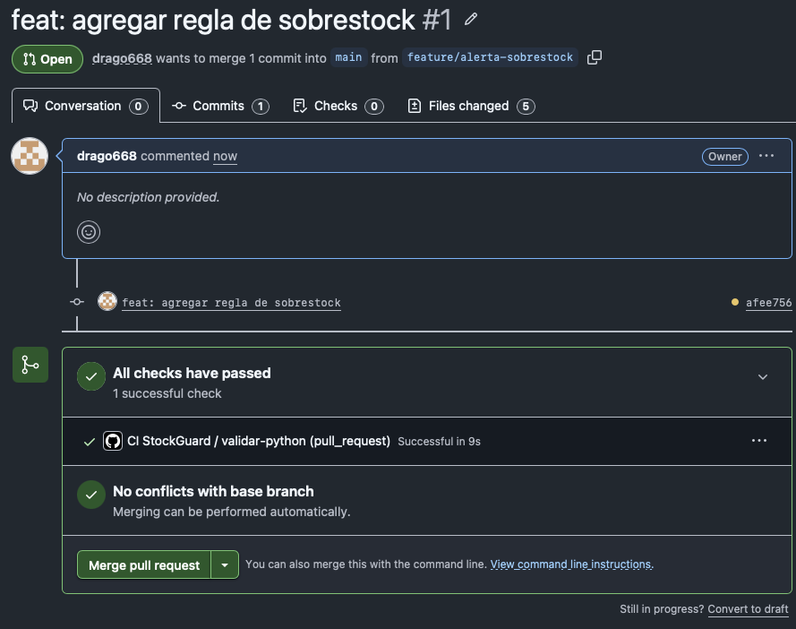

# StockGuard — práctica de CI con GitHub Actions

[](https://github.com/drago668/github-actions-stockguard/actions/workflows/ci.yml)

Práctica de integración continua (CI) sobre un caso sencillo de control de inventario:
clasificar el nivel de riesgo de un producto según su stock disponible y el stock mínimo
requerido, probar la regla con `pytest` y automatizar las verificaciones con GitHub Actions.

## Regla de negocio

| Condición                                                 | Resultado      |
| ---------------------------------------------------------- | -------------- |
| El stock actual es 0                                       | `AGOTADO`    |
| El stock actual es menor o igual al 50 % del stock mínimo | `CRITICO`    |
| El stock actual es menor o igual al stock mínimo          | `BAJO`       |
| El stock actual supera 5 veces el stock mínimo            | `SOBRESTOCK` |
| En cualquier otro caso                                     | `NORMAL`     |
| Stock negativo, o stock mínimo menor o igual a cero       | `ValueError` |

## Estructura del repositorio

```text
github-actions-stockguard/
├── .github/
│   └── workflows/
│       └── ci.yml
├── src/
│   ├── __init__.py
│   └── inventario.py
├── tests/
│   └── test_inventario.py
├── docs/
│   └── img/
├── requirements.txt
└── README.md
```

## Cómo ejecutar

```bash
python -m pip install -r requirements.txt
python -m pytest -v
```

## Qué valida el CI

El workflow `.github/workflows/ci.yml` se ejecuta en cada `push` y `pull_request` hacia
`main`, y también de forma manual (`workflow_dispatch`). El job `validar-python` corre en
`ubuntu-latest` y ejecuta estos pasos:

1. Descarga del repositorio (`actions/checkout`).
2. Configuración de Python 3.12 (`actions/setup-python`).
3. Instalación de dependencias desde `requirements.txt`.
4. Validación de sintaxis con `python -m compileall src tests`.
5. Ejecución de las pruebas con `python -m pytest -v`.

## Pruebas en local

Primera ejecución local con las cuatro pruebas iniciales de la regla de clasificación:



## Primeras ejecuciones en GitHub Actions

Al subir el workflow, las dos primeras ejecuciones fallaron. La causa no era el código:
el archivo `ci.yml` tenía un error de sintaxis YAML en la línea 6.





Corregido el YAML, el job `validar-python` terminó correctamente en 9 segundos. Este fue el
primer paso exitoso del proyecto dentro de Actions:



## Ejecución de pruebas

Salida del step **Ejecutar pruebas** dentro del runner de GitHub, con las cuatro pruebas en
verde:



Después de agregar las pruebas de las nuevas funciones, la ejecución local reporta diez
pruebas:



## Preguntas de análisis

Las siguientes respuestas corresponden al fallo provocado a propósito en
`test_stock_critico`, cambiando el resultado esperado para que la prueba no coincidiera con
el valor real.

### ¿Qué step falló?

Falló el step **Ejecutar pruebas**, donde se ejecutan todas las pruebas y donde está
`test_stock_critico`, que fue el lugar donde se provocó el fallo a propósito.

### ¿Qué mensaje produjo pytest?

Arrojó el siguiente mensaje:

```text
1. FAILED tests/test_inventario.py::test_stock_critico - AssertionError: assert 'CRITICO' == 'NORMAL'
```

Esperaba recibir `CRITICO`, pero recibió `NORMAL`, así que la prueba no pasó. Aun así, el
resto del proceso siguió ejecutándose con normalidad y las demás pruebas sí pasaron.

### ¿Los steps anteriores habían terminado correctamente?

Sí. Todos los steps anteriores terminaron de forma adecuada, porque lo único que cambió fue
el código que se evalúa, no la forma en que GitHub Actions ejecuta las pruebas.

### ¿Qué diferencia visual encuentras entre esta ejecución y la anterior?

En esta ejecución el job de validación de Python muestra visualmente que algo falló, marcado
con una ❌ en rojo, mientras que en la ejecución anterior aparecía el símbolo de "check" ✔.
Al abrir los steps, la ❌ aparece específicamente en el step de ejecución de pruebas y todos
los demás conservan su ✔.

## Paso 7 — Reglas adicionales

Enlace al PR [[github.com/drago668/github-actions-stockguard/pull/1](https://github.com/drago668/github-actions-stockguard/pull/1)]


Se agregan las funciones para evaluar el sobrestock y calcular porcentajes de inventario.

### `src/inventario.py`

```python
def clasificar_stock(stock_actual: int, stock_minimo: int) -> str:
    if stock_actual < 0:
        raise ValueError("El stock actual no puede ser negativo")
    if stock_minimo <= 0:
        raise ValueError("El stock minimo debe ser mayor que cero")
    if stock_actual == 0:
        return "AGOTADO"
    if stock_actual <= stock_minimo * 0.5:
        return "CRITICO"
    if stock_actual <= stock_minimo:
        return "BAJO"
    if stock_actual > (stock_minimo * 5):
        return "SOBRESTOCK"
    return "NORMAL"


def calcular_porcentaje(stock_actual: float, stock_maximo: float) -> float:
    if stock_actual < 0 or stock_maximo < 0:
        raise ValueError("El stock no puede ser negativo")
    if stock_maximo == 0:
        raise ZeroDivisionError("El stock máximo no puede ser cero")
    return (stock_actual / stock_maximo) * 100
```

### `tests/test_inventario.py`

Se prueban dichas funciones en `tests/test_inventario.py`:

```python
import pytest
from src.inventario import clasificar_stock, calcular_porcentaje


def test_stock_agotado():
    assert clasificar_stock(0, 20) == "AGOTADO"


def test_stock_critico():
    assert clasificar_stock(7, 20) == "CRITICO"


def test_stock_bajo():
    assert clasificar_stock(15, 20) == "BAJO"


def test_stock_normal():
    assert clasificar_stock(30, 20) == "NORMAL"


# test sobrestock
def sobrestock():
    assert clasificar_stock(150, 20) == "SOBRESTOCK"


def stock_invalido():
    with pytest.raises(ValueError):
        clasificar_stock(-2, 20)


# tests cálculo de porcentaje
def test_calcular_porcentaje_normal():
    assert calcular_porcentaje(30, 100) == 30.0
    assert calcular_porcentaje(450, 600) == 75.0


def test_calcular_porcentaje_con_decimales():
    assert calcular_porcentaje(1, 3) == pytest.approx(33.333, abs=1e-3)


def test_calcular_porcentaje_limites():
    assert calcular_porcentaje(0, 100) == 0.0
    assert calcular_porcentaje(100, 100) == 100.0


def test_calcular_porcentaje_sobrestock():
    assert calcular_porcentaje(150, 100) == 150.0


def test_calcular_porcentaje_division_por_cero():
    with pytest.raises(ZeroDivisionError):
        calcular_porcentaje(50, 0)


def test_calcular_porcentaje_valores_negativos():
    with pytest.raises(ValueError):
        calcular_porcentaje(-10, 100)
```

## Push, Pull Request y merge

Las pruebas también se ejecutaron en local antes del `push`, para asegurar la calidad del
código: todas salieron exitosas. El run #8 del workflow terminó en verde en 9 segundos.

#8#8 exitoso" />

Como último paso, una vez hecho el `push` se creó el Pull Request #1
(`feature/alerta-sobrestock` → `main`). GitHub ejecutó las pruebas automáticamente
(`CI StockGuard / validar-python`), salieron exitosas y sin conflictos con la rama base, por
lo que la fusión quedó habilitada.




# Preguntas de analisis

1. Ejecución exitosa vs. fallida
   La fallida es el run #5  "test: provocar fallo controlado de CI". Ahí cambié a propósito una línea de tests/test_inventario.py: assert clasificar_stock(7, 20) == "NORMAL" cuando el valor correcto es "CRITICO". El step que determinó el resultado fue Ejecutar pruebas.
   La exitosa es el run #6  que restauró el valor esperado. El mismo step Ejecutar pruebas terminó en verde. El contraste es limpio: entre un run y otro solo cambió la expectativa de la prueba, no el workflow. Más adelante el run #8, sobre afee756, validó el Pull Request #1 y también salió exitoso.
2. ¿Por qué pytest local no reemplaza pytest en GitHub Actions?
   Porque prueban cosas distintas. En mi máquina pytest pasa, pero corre con mi entorno: mi versión de Python, mis dependencias ya instaladas y, sobre todo, archivos que puedo tener sin subir. Actions parte de un runner limpio: descarga solo lo que está en el repositorio, instala desde requirements.txt y usa la versión de Python que declara el workflow. El caso más claro que viví: mis 4 pruebas pasaban en local, pero las ejecuciones #1, #2 y #3 fallaron antes de correr una sola prueba porque el ci.yml tenía un error de sintaxis YAML en la línea 6. Eso solo lo detecta GitHub, no pytest.
3. Riesgo de hacer merge sin esperar los checks
   Que main quede roto y el error se propague. En mi caso, entre el run #5 y el #6 main estuvo unos 17 minutos en rojo. Si hubiera mergeado el PR con ese fallo, cualquiera que partiera de main heredaría el error y no sabría si la falla es suya o viene de antes. Además se pierde el quality gate: el release o el tag quedaría sobre un código que nunca pasó las verificaciones, y el check deja de ser confiable porque uno se acostumbra a ignorarlo.
4. Línea esencial del error
   AssertionError: assert 'CRITICO' == 'NORMAL'
   Me permitió diagnosticar tres cosas de una vez: qué prueba falló (test_stock_critico, que aparece en la línea FAILED), cuál era el valor esperado (CRITICO) y cuál se obtuvo (NORMAL). Como los steps anteriores estaban en verde y el único cambio era la aserción, supe que el problema estaba en la prueba y no en la lógica de clasificar_stock.
5. Diferencia entre uses: y run:
   uses: invoca una acción ya publicada por otro (o por GitHub), con su versión fija: actions/checkout@v4 descarga el repositorio y actions/setup-python@v5 prepara Python. No escribo su código, solo la llamo. run: ejecuta comandos de shell en el runner, que yo escribo: python -m compileall src tests o python -m pytest -v. En resumen: uses reutiliza una herramienta empaquetada; run ejecuta lo que el sistema operativo del runner entiende.
6. Qué aporta ${{ github.actor }} en run-name
   Es el usuario que disparó la ejecución. En mi repo el nombre queda como "CI ejecutado por drago668", y se ve igual en el run #7, que ejecuté manualmente con workflow_dispatch. En un equipo de tres personas eso es trazabilidad: permite demostrar quién ejecutó cada verificación sin revisar los logs, saber a quién preguntar si un run falló y dejar la evidencia individual que exige el proyecto. También ayuda a distinguir un fallo introducido por un cambio propio de uno que ya venía de la rama.
7. Si el workflow pasa pero Docker falla, ¿Actions "no sirve"?
   Actions está verificando calidad del código y del repositorio, que la sintaxis sea válida, que las dependencias se instalen desde cero, que las reglas de negocio pasen las pruebas y que el docker-compose.yml tenga estructura válida. Lo que no hace es levantar Kafka, Spark y Airflow ni ejecutar el streaming real. Si el pipeline completo falla en mi máquina, lo más probable es un problema de entorno: falta de memoria para los contenedores, una imagen que no se descargó, un puerto ocupado o un checkpoint viejo. Eso se valida localmente y se documenta; automatizarlo en cada push sería lento y frágil (lo dejé consignado en el ADR-002 de RapidGo).
8. Tres checks para mi variante (Demanda por zonas)

- Contrato del evento: validar que cada pedido traiga pedido_id, zona, timestamp, categoria y estado, con zonas y estados permitidos y un timestamp parseable. Evitaría lo que ya nos pasó: un evento de ejemplo con zona: "Norte" y estado: "creado" que Spark descarta en el filtro estado == "CREADO", dejando la alerta de capacidad en cero sin que nadie lo note.
- Umbrales de alerta con casos límite: probar 35, 36, 50, 51, 80 y 81 pedidos. Evitaría que alguien cambie un > por >= o mueva una constante y la alerta crítica deje de dispararse (o dispare siempre), un error que las pruebas de sintaxis nunca verían.
- docker compose config --quiet: evitaría un docker-compose.yml inválido que impide levantar Kafka y Spark. Es el mismo tipo de error que me tumbó las tres primeras ejecuciones en StockGuard, pero aplicado al compose.

9. ¿Cuál implementar primero?
   El del contrato del evento. Es la entrada de todo el pipeline: si el evento no cumple, las ventanas, los KPIs y las alertas quedan mal aunque los umbrales estén perfectos. Además ya demostró su valor porque encontró un defecto real en samples/example_event.json, y es el check más barato: Python puro, sin Kafka, sin Spark y sin Docker.
10. ¿Qué prueba sería demasiado costosa o frágil en cada push?
    Levantar el stack completo (Kafka + Spark + Airflow) y esperar a que se cierren las ventanas de 5, 10 y 60 minutos con sus watermarks. Es costoso en tiempo y memoria del runner, y frágil porque los tiempos no son deterministas: un push podría fallar por recursos y no por el código. Lo validaría de dos formas: con la demostración local documentada y con un workflow manual (workflow_dispatch) o programado que levante solo Kafka y el producer unos minutos y compruebe que aparecen archivos en datalake/curated. En el CI de cada push dejaría únicamente docker compose config, que valida la estructura sin levantar nada.
